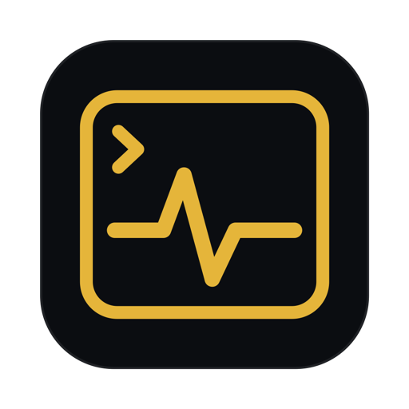
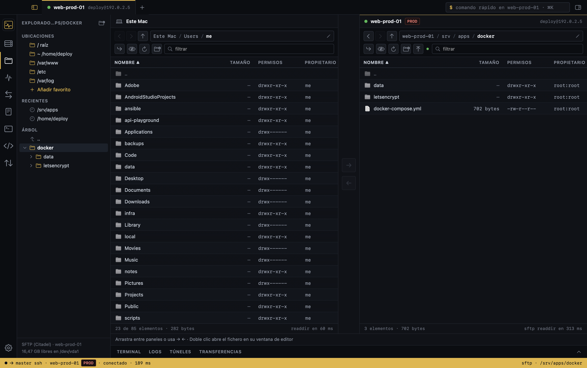
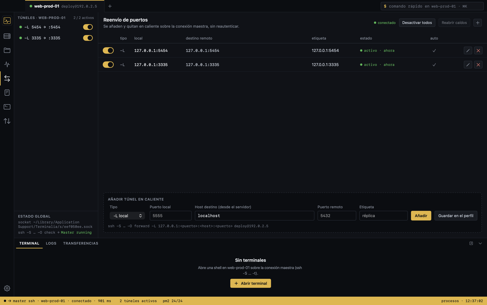
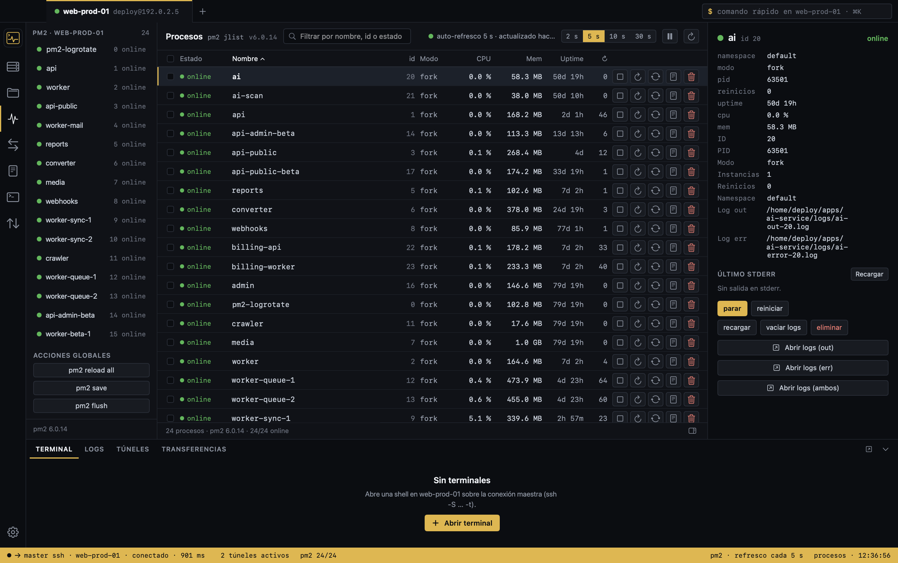
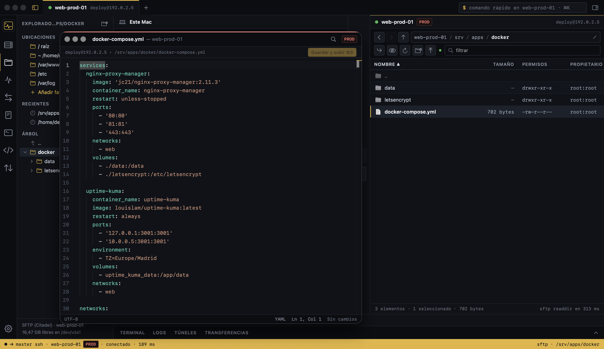
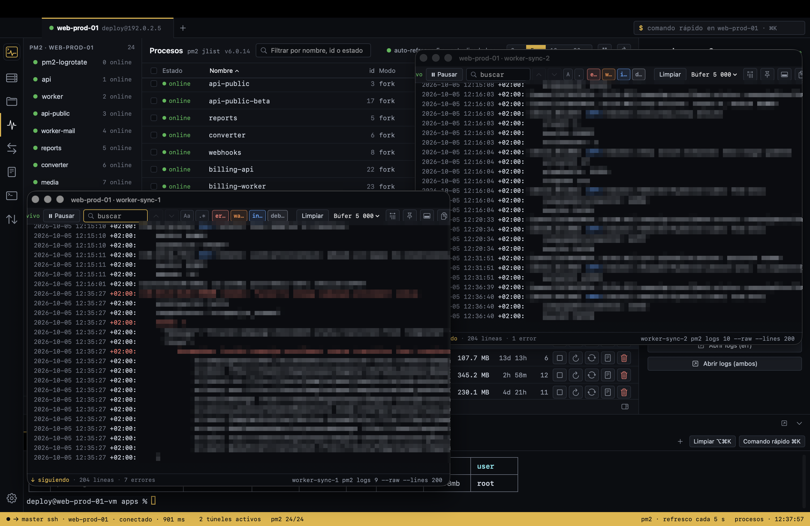
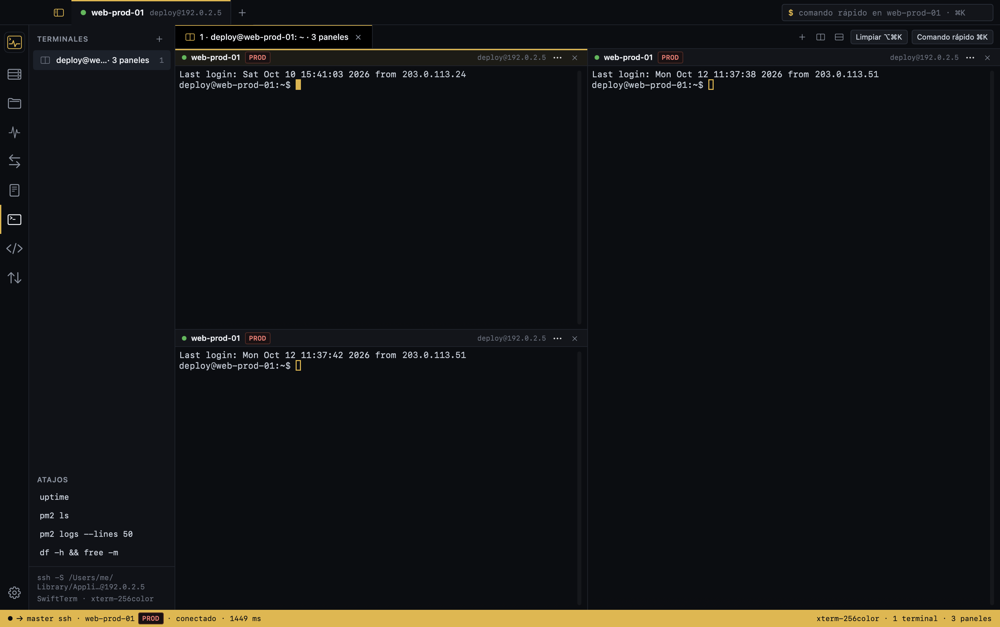
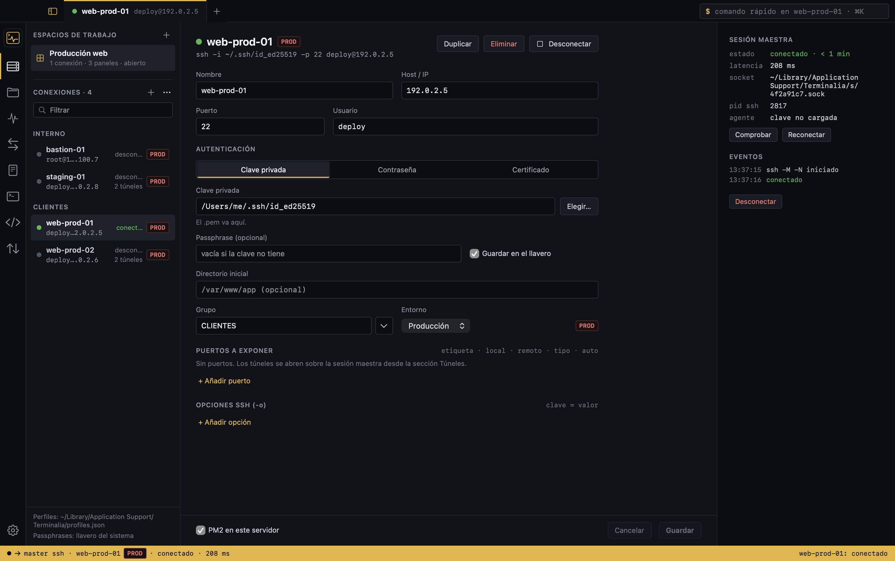

<p align="center">
  
</p>

<h1 align="center">Terminalia</h1>

<p align="center">
  <strong>Free native SSH client for Mac.</strong><br>
  Import your <code>~/.ssh/config</code> and get SFTP, a remote editor, SSH tunnels, PM2 and Docker processes, live logs and a terminal in one window, over a single SSH connection.
</p>

<p align="center">
  <a href="https://github.com/agustinalonsocantoli/terminalia/releases/latest"><strong>Download the latest release</strong></a> ·
  <a href="https://terminalia.dev/en">Website</a> ·
  <a href="https://terminalia.dev/en/changelog">Changelog</a> ·
  <a href="https://terminalia.dev/en/support">Support</a>
</p>

<p align="center">
  
</p>

## What it is

Terminalia is a free SSH client for macOS. It uses the OpenSSH that already ships with your Mac and the hosts you already have in `~/.ssh/config`, ProxyJump included. Everything runs over one master connection (ControlMaster), so files, tunnels, processes, logs and the terminal share a single SSH session.

- **No account.** Nothing to sign up for.
- **No telemetry.** The app sends no analytics.
- **Works offline.** The editor is bundled with the app; it only talks to your servers over SSH.
- **Your config stays yours.** Profiles come from `~/.ssh/config`; key passphrases and saved server passwords live in the macOS Keychain.

## Features

| | |
|---|---|
| **Connections** | Import hosts from `~/.ssh/config` with preview, including LocalForward, RemoteForward, DynamicForward, ProxyJump and CertificateFile. Groups and PROD / STG / DEV badges. Two-factor authentication (verification codes, Duo) with one code per connection. Master session with automatic reconnect and a status panel (socket, PID, latency). |
| **Tunnels** | `-L`, `-R` and SOCKS (`-D`) forwards you can toggle live, auto-start on connect, and detection of busy local ports. |
| **Snippets** | Save named commands, paste them into the terminal or run them on a connection, also from the ⌘K palette. |
| **SFTP and editor** | Dual-pane browser with your Mac on one side and the server on the other: copy both ways with → / ← or drag and drop. Each file opens in its own editor window, with atomic saves and a diff view. |
| **Processes** | PM2 and Docker Compose in one panel: start, stop, restart, grouped by project. Works with pm2 installed through nvm or Homebrew. |
| **Logs and terminal** | Live PM2, Docker and file logs with search and filters. Built-in terminal with split panes, search (⌘F) and workspaces you can restore in one click, plus a ⌘K command palette. |
| **Your way** | Hide or show the sidebar, process column and bottom panel, and change every keyboard shortcut in Settings. |

<p align="center">
  
  
</p>
<p align="center">
  
  
</p>

<p align="center">
  
  
</p>

## Requirements

- macOS 14 Sonoma or later
- Apple Silicon or Intel (universal binary)
- Sign in with a private key (ed25519, ECDSA or RSA), username and password, or an OpenSSH user certificate, with or without two-factor authentication (MFA).
- Spanish or English interface.

## Install

1. Download `Terminalia-1.3.0.dmg` from [Releases](https://github.com/agustinalonsocantoli/terminalia/releases/latest) or from [terminalia.dev](https://terminalia.dev/en/download).
2. Open the DMG and drag Terminalia to Applications.
3. The first time, macOS will block it because the app is not notarized by Apple yet. Go to **System Settings › Privacy & Security** and click **Open Anyway**. You only need to do this once.

Verify the download (optional):

```sh
shasum -a 256 ~/Downloads/Terminalia-1.3.0.dmg
# 2f7f60cbf901dcb2440f834e650b861affc6e894ed8f7bce6b4bcddd4456a168
```

### Homebrew

```sh
brew tap agustinalonsocantoli/tap && brew trust --cask agustinalonsocantoli/tap/terminalia && brew install --cask agustinalonsocantoli/tap/terminalia
```

Homebrew 7 and later asks you to trust a third-party tap before installing a cask from it; that is what `brew trust` does. Since 1.3.0 the app updates itself from inside (Terminalia › Check for Updates…).

## Guides

- [SSH tunnels on Mac: -L, -R and -D](https://terminalia.dev/en/guides/ssh-tunnel-mac)
- [~/.ssh/config with examples](https://terminalia.dev/en/guides/ssh-config)
- [ProxyJump through a bastion](https://terminalia.dev/en/guides/proxyjump-bastion)
- [Terminalia vs Termius](https://terminalia.dev/en/termius-alternative)

## Feedback and bugs

Use the [contact form](https://terminalia.dev/en/support) to report a bug, or [request a feature](https://terminalia.dev/en/changelog) on the changelog page.

## License

Terminalia is free to download and use. It is not open source: this repository hosts releases and documentation only. © 2026 Terminalia. All rights reserved.
